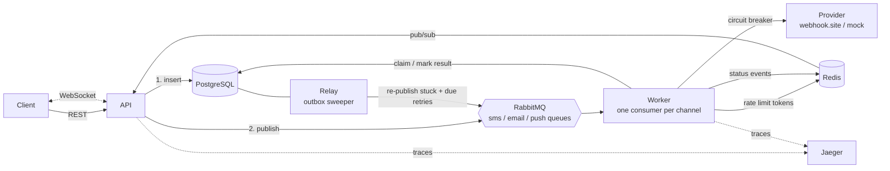

# Event-Driven Notification System

A scalable notification service written in Go. Clients submit SMS, e-mail and push notifications through a REST API;
they are persisted, queued in RabbitMQ and delivered asynchronously by workers to an external provider — with
priorities, rate limiting, retries, idempotency, scheduling, templates, live status over WebSocket and distributed tracing.

```bash
docker compose up --build        # the whole stack, one command
```

| What | Where |
|---|---|
| REST API | http://localhost:8080/api/v1 |
| Swagger UI (OpenAPI 3) | http://localhost:8080/docs |
| Distributed traces (Jaeger) | http://localhost:16686 |
| RabbitMQ management | http://localhost:15672 (guest / guest) |
| Mock provider | http://localhost:9090 |

## Architecture



**Request path.** `POST /notifications` validates the request, writes the row to PostgreSQL (status `pending`, or
`scheduled`) and publishes `{id, channel, priority}` to a RabbitMQ direct exchange (routing key = channel). If the
publish fails, the row is still safe in the database and the **relay** (a small outbox sweeper running in both the API and
the worker) publishes it later. Messages carry only the id: the worker always reads the current state from PostgreSQL, so a
notification cancelled while queued is never sent.

**Delivery.** The worker atomically *claims* a notification (`pending → processing`, one `UPDATE`), takes a token from a
Redis token bucket (100 msg/s per channel, shared by all worker instances), calls the provider and records the result.

## API

All endpoints live under `/api/v1`. Full schemas and examples: **Swagger UI at `/docs`** (spec at `/openapi.yaml`).

| Method | Path | Purpose |
|---|---|---|
| POST | `/notifications` | Create one notification (optional `Idempotency-Key`, `scheduled_at`, or `template_id` + `variables`) |
| POST | `/notifications/batch` | Create up to 1000 notifications atomically |
| GET | `/notifications/{id}` | Status of one notification |
| GET | `/notifications` | List with filters (`status`, `channel`, `batch_id`, date range) and cursor pagination |
| POST | `/notifications/{id}/cancel` | Cancel a `pending` / `scheduled` notification |
| GET | `/batches/{id}` | Per-status counts of a batch |
| POST/GET/DELETE | `/templates`, `/templates/{id}` | Manage message templates |
| GET | `/ws?id=<uuid>&id=…` or `?all=true` | Live status stream (WebSocket) |

```bash
# send an SMS
curl -X POST localhost:8080/api/v1/notifications -H 'Content-Type: application/json' \
  -H 'Idempotency-Key: order-42-confirmation' \
  -d '{"recipient":"+905551234567","channel":"sms","content":"Your order has shipped","priority":"high"}'

# schedule one for later
curl -X POST localhost:8080/api/v1/notifications -H 'Content-Type: application/json' \
  -d '{"recipient":"ada@example.com","channel":"email","content":"Reminder","scheduled_at":"2030-01-01T09:00:00Z"}'

# use a template
TID=$(curl -s -X POST localhost:8080/api/v1/templates -H 'Content-Type: application/json' \
  -d '{"name":"otp","body":"Hi {{name}}, your code is {{code}}"}' | jq -r .id)
curl -X POST localhost:8080/api/v1/notifications -H 'Content-Type: application/json' \
  -d "{\"recipient\":\"+905551234567\",\"channel\":\"sms\",\"template_id\":\"$TID\",\"variables\":{\"name\":\"Ada\",\"code\":\"482913\"}}"

# watch a notification live
go run ./cmd/wsclient <notification-id>
```

Status lifecycle: `scheduled → pending → processing → sent | failed`, or `cancelled`. A failed attempt that will be
retried goes back to `pending` with a `next_attempt_at`.

Errors share one shape: `{"error":{"code","message","fields":[{"field","message"}]}}`. Validation returns **all** invalid
fields at once (`422`); batch errors are addressed as `notifications[3].recipient`.

## Requirements → implementation

| Requirement | How |
|---|---|
| Create / batch (≤1000) / status / cancel / list | Endpoints above. Batch is all-or-nothing in a single transaction. List uses keyset pagination with an opaque cursor. |
| Channels SMS / e-mail / push, content limits | Per-channel validation (E.164 phone, e-mail address, device token; 160 / 10000 / 256 characters). |
| Priority (high / normal / low) | RabbitMQ priority queues (`x-max-priority: 3`); small consumer prefetch so priority order is preserved. |
| Asynchronous processing, one queue per channel | Direct exchange, queues `notifications.sms|email|push`, one consumer set per channel so a slow channel cannot starve the others. |
| Rate limit 100 msg/s per channel | Redis Lua token bucket, shared across all worker replicas. |
| Retry with exponential backoff | Database-driven: `Base·2^n`, capped, equal jitter, honours `Retry-After`, max 5 attempts; permanent 4xx fails immediately. |
| Idempotency | `Idempotency-Key` header. Redis fast path (fail-open) + PostgreSQL partial unique index as the source of truth. Same key + same payload → `200` replay; different payload → `409`. |
| Provider integration | `internal/provider` HTTP client (timeout, error classification: retryable vs. permanent); `cmd/mockprovider` simulates 202 / 4xx / 5xx / 429 / slow responses for local runs. |
| **Bonus** failure handling | Per-channel **circuit breaker** (closed → open → half-open); an open circuit defers notifications without burning retry attempts. |
| **Bonus** scheduled notifications | `scheduled_at`; the relay promotes due rows to `pending`. Cancellable until due. |
| **Bonus** template system | `{{variable}}` placeholders, strict missing-variable validation, single-pass substitution (no template injection). |
| **Bonus** WebSocket | `/ws` streams status events; worker → API via Redis pub/sub; initial snapshot on subscribe; slow clients are dropped. |
| **Bonus** distributed tracing | OpenTelemetry → Jaeger. One trace spans API → DB → queue → worker → provider, including retries. |
| **Bonus** CI/CD | GitHub Actions: gofmt, vet, race-enabled tests, and a Docker Compose smoke test (create → delivered). |

## Key design decisions

- **At-least-once delivery, effectively-once sending.** RabbitMQ may redeliver, so the worker's atomic `claim`
  (`UPDATE … WHERE status='pending' OR stale lease`) guarantees only one worker sends a given notification. A crashed
  worker's notification is recovered after a lease timeout (120 s).
- **PostgreSQL is the source of truth; the queue is a hint.** Retry timing lives in the database (`next_attempt_at`),
  not in RabbitMQ delay tricks. The relay uses `FOR UPDATE SKIP LOCKED`, so many replicas can run safely.
- **Outbox-lite.** The row is committed before publishing; a failed publish never loses a notification.
- **Circuit breaker defers, it doesn't fail.** A provider outage must not exhaust retry budgets and mark thousands of
  notifications `failed`. Deferral restores the attempt counter.
- **Trace context is stored with the notification** (`traceparent` column) so asynchronous hops that happen later
  (relay, retries, scheduled sends) still join the original trace.
- **Layered, interface-driven code.** `handler → service → repository`, interfaces defined by the consumer, manual
  dependency injection, no framework magic; domain logic is unit-testable without infrastructure.
- **Observability of event delivery is best-effort.** WebSocket/pub-sub loss never affects delivery; clients can always
  read the authoritative status via REST.

## Configuration

Defaults work with `docker compose`. Everything is an environment variable.

| Variable | Default | Meaning |
|---|---|---|
| `DATABASE_URL` | local Postgres | PostgreSQL DSN (migrations run automatically on start) |
| `RABBITMQ_URL` / `REDIS_ADDR` | local | Broker and Redis |
| `PROVIDER_URL` | `http://localhost:9090/` | Provider endpoint (set to your webhook.site URL for the real thing) |
| `HTTP_PORT` | `8080` | API port |
| `WORKER_CONCURRENCY` | `5` | Messages processed concurrently per channel |
| `RATE_LIMIT_PER_SEC` | `100` | Per-channel send rate |
| `PROVIDER_TIMEOUT_MS` | `5000` | Provider call timeout |
| `LEASE_SECONDS` | `120` | After this, a stuck `processing` row can be taken over |
| `RETRY_MAX_ATTEMPTS` | `5` | Total attempts including the first |
| `RETRY_BASE_MS` / `RETRY_MAX_MS` | `5000` / `300000` | Backoff base and cap |
| `CB_FAILURE_THRESHOLD` | `5` | Consecutive provider failures that open a channel's circuit |
| `CB_OPEN_TIMEOUT_MS` | `30000` | Open duration before a trial request |
| `OTEL_EXPORTER_OTLP_ENDPOINT` | *(compose sets Jaeger)* | Empty disables tracing |

To use a real endpoint such as webhook.site, run the stack with `PROVIDER_URL=https://webhook.site/<uuid>`.
Content sent: `{"to","channel","content"}`; a `202` with `{"messageId","status","timestamp"}` is expected.

## Development

```bash
make test        # gofmt check + go vet + all unit tests with the race detector
make up          # docker compose up --build -d --wait
make down        # stop and remove volumes
make logs        # follow api + worker logs
```

Tests cover validation, idempotency, batching, scheduling, templates, retry/backoff, the rate limiter, the circuit
breaker, the worker state machine, the relay, the hub (WebSocket fan-out) and trace-context propagation. Database
migrations are versioned SQL files in `migrations/` (`golang-migrate`, embedded in the binary).

```
cmd/            api, worker, mockprovider, wsclient
internal/
  domain/         entities, validation, errors (no infrastructure imports)
  service/        use cases
  handler/        HTTP + WebSocket + tracing middleware
  repository/     PostgreSQL / Redis access, migrations runner
  queue/          RabbitMQ topology, publisher, consumer
  relay/          outbox sweeper
  worker/         claim → rate limit → send → record result
  provider/       provider HTTP client      circuitbreaker/   per-channel breaker
  retry/          backoff policy            ratelimit/        Redis token bucket
  events/ realtime/   status events and WebSocket hub
  telemetry/      OpenTelemetry setup       apidocs/          embedded OpenAPI + Swagger UI
migrations/     versioned SQL
```

## Known limitations / next steps

- The circuit breaker state is per worker process (not shared across replicas); sharing it via Redis would make all
  replicas react at once.
- WebSocket events travel over Redis pub/sub (fire-and-forget). Redis Streams would allow replay after reconnect.
- No authentication / multi-tenancy; recipients are validated for format only.
- The API has no pagination on `/templates` (capped at 200).
